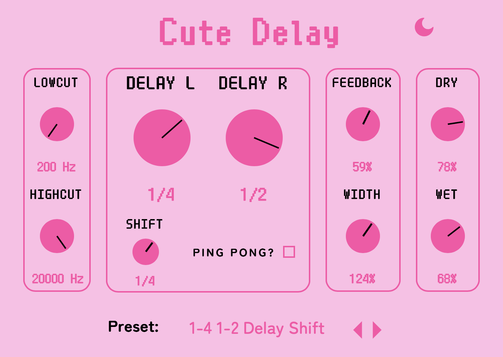

# Cute Delay

Cute Delay is a VST plugin for delay (repeating echo) effects.

### Controls:
- Delay L - The left delay time in bpm synced times.
- Delay R - The right delay time in bpm synced times.
- Shift - The shift for the first repeat in bpm synced times.
- Ping Pong - Changes to ping pong (alternating) delay.
- Feedback - The percentage fed back into the delay, controls the number of repeats.
- Width - The stereo width of the delayed signal.
- Lowcut - Applies a highpass filter to the delayed signal.
- Highcut - Applies a lowpass filter to the delayed signal.
- Dry - The volume of the original signal.
- Wet - The volume of the delayed signal.

I think delay always sounds better when the left and right delay times are different, I love 
the effect of bouncing between your ears. 

### Design

Our design is available here: https://www.figma.com/design/r7YWyrGmRyQdxd6UXErWNV/Cute-Delay

### Purchase

### See Also

- [Cute Filter](https://github.com/Moebytes/Cute-Filter) 
- [Cute Stutter](https://github.com/Moebytes/Cute-Stutter)